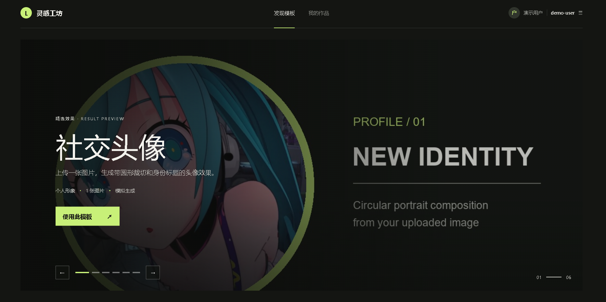
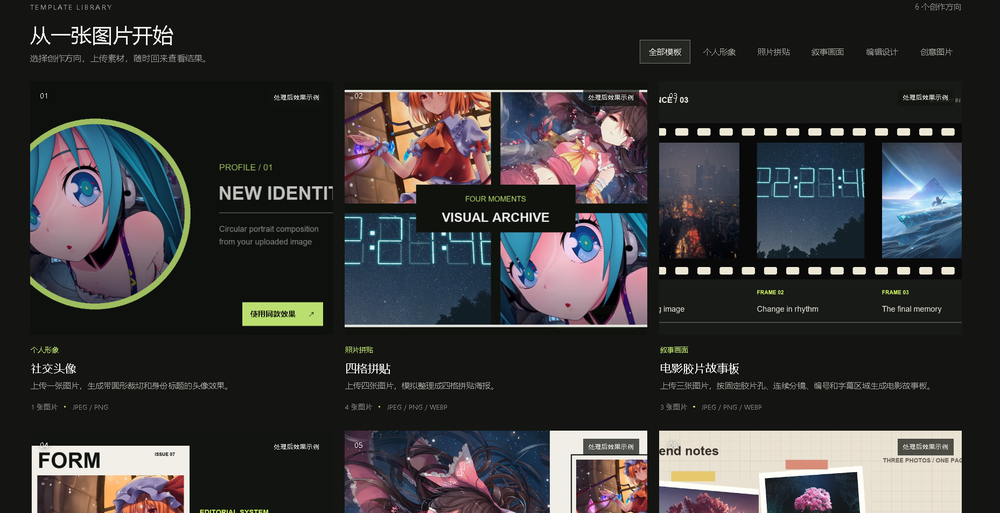
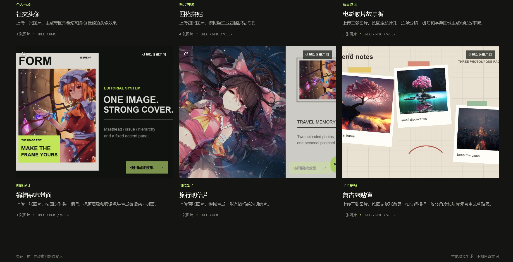
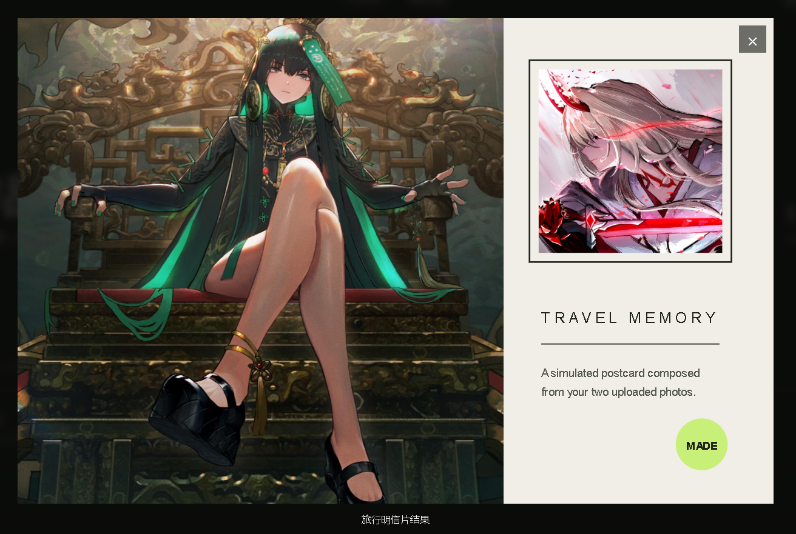
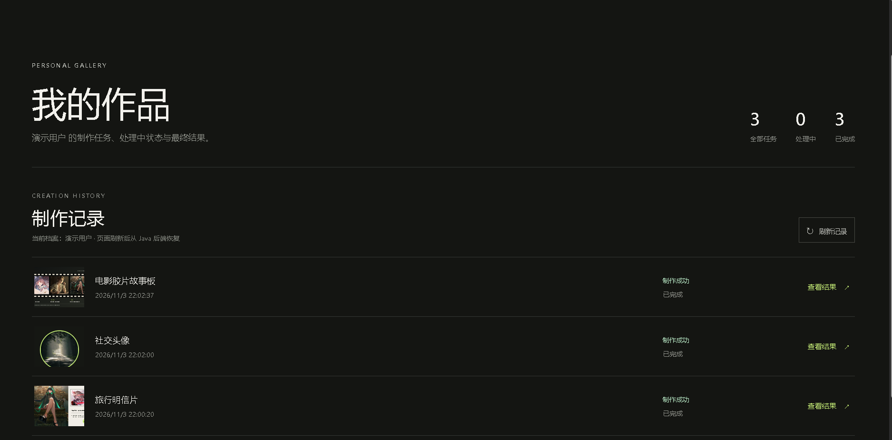
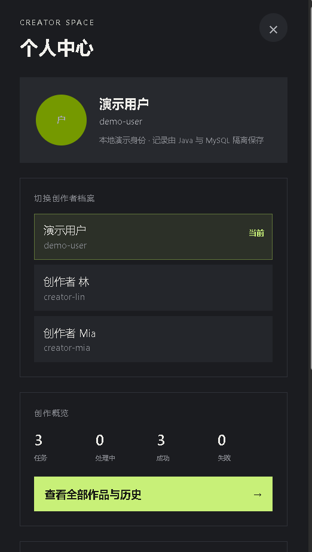
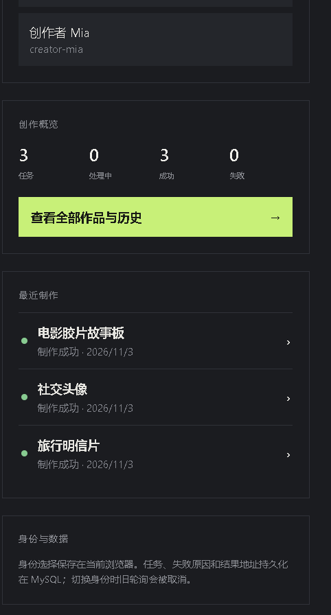
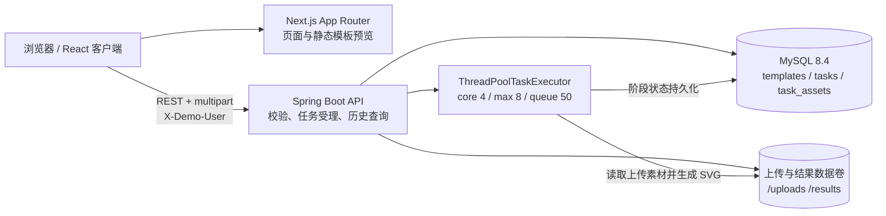
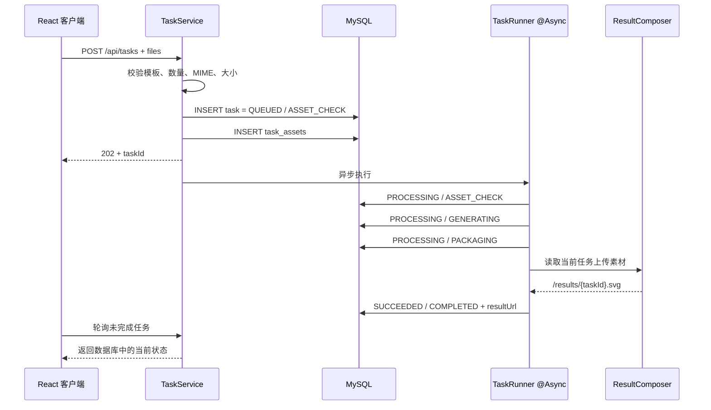

# 灵感工坊：异步素材制作网站

一个可独立运行的素材制作演示系统。用户可以浏览固定版式模板、上传图片、提交制作任务，并在 Java 后台异步处理期间继续浏览网站；任务完成后，可在个人作品页恢复历史记录并预览结果。

项目不调用真实 AI 服务。后端按照模板规则，把当前任务上传的图片组合成任务专属 SVG，以可调整延迟和指定阶段失败的方式模拟完整制作流程。

## 目录

- [项目效果](#项目效果)
- [核心能力](#核心能力)
- [需求覆盖矩阵](#需求覆盖矩阵)
- [技术版本](#技术版本)
- [系统架构](#系统架构)
- [项目结构](#项目结构)
- [快速启动](#快速启动)
- [配置说明](#配置说明)
- [本地开发](#本地开发)
- [数据库与初始化](#数据库与初始化)
- [模板与素材](#模板与素材)
- [主要接口](#主要接口)
- [任务状态与异步执行](#任务状态与异步执行)
- [前端异步状态管理](#前端异步状态管理)
- [用户身份与个人记录](#用户身份与个人记录)
- [演示方法](#演示方法)
- [测试与 CI](#测试与-ci)
- [部署与回滚](#部署与回滚)
- [完成情况与已知限制](#完成情况与已知限制)
- [AI 使用说明](#ai-使用说明)
- [第三方代码与素材说明](#第三方代码与素材说明)
- [验收清单](#验收清单)

## 项目效果

### 首页精选模板

首页使用图像优先的轮播区域展示模板成品效果。轮播每 5 秒自动切换，也支持前后按钮和分页点；鼠标悬停或键盘焦点进入时暂停，避免用户操作过程中自动跳转。



### 模板列表与分类筛选

模板数据来自 Java 接口，不在页面中写死。当前提供 6 个固定规则模板，分类、所需图片数量、格式限制和封面均由后端返回。





### 任务结果预览

模板封面只用于说明版式效果。用户真正提交后，后端读取该任务上传的图片，生成新的任务专属结果，不会直接返回模板示例图。



### 个人作品与刷新恢复

个人作品页独立展示任务总数、处理中数量、完成数量、创建时间、当前状态、失败原因和成功结果。页面刷新后重新从 Java 后端读取 MySQL 记录，并继续跟踪未结束任务。



### 用户身份与个人中心

右上角身份按钮打开个人中心侧栏，可切换本地演示身份、查看任务统计和最近制作，并进入完整历史页。

<p align="center">
  
  
</p>

## 核心能力

- Java 提供模板、上传、任务查询和个人历史接口。
- MySQL 持久化模板、任务状态、处理阶段、失败原因和结果地址。
- Spring `@Async` 后台执行素材检查、模拟生成、结果整理三个步骤。
- 提交接口完成校验和任务创建后立即返回 HTTP `202`，不等待生成结束。
- 前端区分上传、提交、等待处理、处理中、成功、失败和查询异常。
- 支持连续创建多个任务，各任务状态按任务 ID 独立合并。
- 只轮询未完成任务；任务全部结束后停止轮询。
- 切换身份或离开页面时取消旧请求，避免旧用户结果覆盖当前用户。
- 刷新页面后恢复个人历史，并继续跟踪未结束任务。
- 支持指定阶段失败和调整处理耗时。
- 支持 Docker Compose 一次启动前端、后端和 MySQL。

## 需求覆盖矩阵

| 要求 | 状态 | 对应实现 |
|---|---|---|
| R-01 技术栈与职责 | 已完成 | Next.js 客户端调用 Java API；业务执行和 MySQL 持久化均在后端 |
| R-02 模板列表与模拟数据 | 已完成 | 6 个数据库种子模板、分类筛选、Java 模板接口 |
| R-03 详情、上传与校验 | 已完成 | 动态上传位、预览/替换/移除、前后端数量/类型/大小校验 |
| R-04 受理与异步执行 | 已完成 | HTTP 202 返回任务，`@Async` 后台继续执行 |
| R-05 多步骤状态与查询 | 已完成 | 三阶段数据库状态、查询只读、成功终态稳定 |
| R-06 失败与模拟控制 | 已完成 | `FAIL_STAGE` 和 `TASK_DELAY_MS` |
| R-07 状态表达与请求异常 | 已完成 | 上传/提交/任务/查询异常分别表达，查询失败不改任务终态 |
| R-08 多任务与查询生命周期 | 已完成 | 按 ID 合并、仅轮询未完成任务、身份切换取消旧请求 |
| R-09 刷新恢复与结果记录 | 已完成 | `/creations` 从 Java 恢复历史并预览成功结果 |
| R-10 用户身份与个人记录 | 已完成 | 本地演示档案、`X-Demo-User`、MySQL 用户隔离 |
| R-11 视觉与基本可用性 | 已完成 | 桌面和小屏可操作、键盘焦点、语义标签和状态反馈 |
| R-12 CI 与关键测试 | 已完成 | GitHub Actions、后端步骤测试、前端多任务/异常测试 |
| R-13 提交材料与说明 | 已完成 | 完整源码、锁文件、初始化脚本、README、限制和 AI 工作流 |
| R-14 推荐容器交付 | 已实现；本次镜像重建受网络阻塞 | 前端、Java、MySQL 的 Dockerfile 与 Compose，配置解析已通过 |

## 技术版本

| 层级 | 技术 | 版本 |
|---|---|---:|
| 前端框架 | Next.js App Router | 14.2.15 |
| UI | React / React DOM | 18.3.1 |
| 语言 | TypeScript | 5.7.2 |
| 前端测试 | Vitest | 2.1.9 |
| 前端运行时 | Node.js | 20（Docker 镜像） |
| 后端语言 | Java | 21 |
| 后端框架 | Spring Boot | 3.3.5 |
| 数据访问 | MyBatis Spring Boot Starter | 3.0.3 |
| 构建工具 | Maven | 3.9.9（Docker 构建镜像） |
| 数据库 | MySQL | 8.4 |
| 容器编排 | Docker Compose | Compose Specification |

## 系统架构



浏览器中的 React 客户端直接调用 Java API。Next.js 负责页面、交互和静态预览资源，不承担业务任务执行或任务持久化。

## 项目结构

```text
.
├─ backend/
│  ├─ src/main/java/com/example/material/
│  │  ├─ config/               # CORS、静态文件映射、异步线程池
│  │  ├─ model/                # Template、Task、TaskAsset
│  │  ├─ repo/                 # MyBatis Mapper
│  │  ├─ service/
│  │  │  ├─ TaskService.java   # 校验、上传保存、任务创建
│  │  │  ├─ TaskRunner.java    # 三阶段异步执行
│  │  │  └─ ResultComposer.java# 按模板生成任务专属 SVG
│  │  └─ web/ApiController.java
│  ├─ src/main/resources/
│  │  ├─ application.yml
│  │  ├─ schema.sql            # 数据表
│  │  └─ data.sql              # 6 个模板种子
│  ├─ src/test/                # 步骤顺序、失败中断、结果素材测试
│  ├─ Dockerfile
│  └─ pom.xml
├─ frontend/
│  ├─ app/
│  │  ├─ page.tsx              # 模板首页
│  │  └─ creations/page.tsx    # 个人作品页
│  ├─ components/studio-app.tsx# 上传、轮询、身份和页面交互
│  ├─ lib/task-state.ts        # 多任务状态合并
│  ├─ lib/task-state.test.ts
│  ├─ public/demo/             # 模板预览和授权展示素材
│  ├─ Dockerfile
│  └─ package.json
├─ docs/screenshots/           # README 界面截图
├─ scripts/generate_preview_assets.py
├─ .github/workflows/ci.yml
├─ .env.example
├─ docker-compose.yml
└─ README.md
```

## 快速启动

### 前置条件

- Docker Desktop 或兼容的 Docker Engine。
- Docker Compose V2，命令为 `docker compose`。
- 本机端口 `3000`、`8080`、`3307` 未被其他程序占用。

### 1. 准备配置

PowerShell：

```powershell
Copy-Item .env.example .env
```

Linux / macOS：

```bash
cp .env.example .env
```

`.env.example` 只包含本地演示值，没有真实凭据。直接使用默认值即可启动。

### 2. 启动完整环境

```bash
docker compose up --build
```

后台启动：

```bash
docker compose up -d --build
```

### 3. 访问

| 服务 | 地址 |
|---|---|
| 前端网站 | `http://localhost:3000` |
| 个人作品 | `http://localhost:3000/creations` |
| Java API | `http://localhost:8080/api` |
| MySQL | `localhost:3307` |

### 4. 停止

保留任务、数据库和上传结果：

```bash
docker compose down
```

删除容器并同时删除 MySQL、上传和结果数据：

```bash
docker compose down -v
```

`down -v` 会永久删除本地演示数据，只应在确定需要重置环境时使用。

## 配置说明

`.env.example`：

```dotenv
MYSQL_DATABASE=material_app
MYSQL_USER=material
MYSQL_PASSWORD=material
MYSQL_ROOT_PASSWORD=root

TASK_DELAY_MS=1200
FAIL_STAGE=none

CORS_ORIGIN=http://localhost:3000
NEXT_PUBLIC_API_URL=http://localhost:8080/api
```

| 配置项 | 默认值 | 作用 |
|---|---|---|
| `MYSQL_DATABASE` | `material_app` | 数据库名 |
| `MYSQL_USER` | `material` | 本地演示数据库用户 |
| `MYSQL_PASSWORD` | `material` | 本地演示数据库密码 |
| `MYSQL_ROOT_PASSWORD` | `root` | MySQL 容器 root 演示密码 |
| `TASK_DELAY_MS` | `1200` | 每个后台步骤的模拟耗时，单位毫秒 |
| `FAIL_STAGE` | `none` | 指定失败阶段：`ASSET_CHECK`、`GENERATING`、`PACKAGING` |
| `CORS_ORIGIN` | `http://localhost:3000` | Java API 允许的前端来源 |
| `NEXT_PUBLIC_API_URL` | `http://localhost:8080/api` | 浏览器访问 Java API 的地址 |
| `STORAGE_DIR` | Compose 中为 `/data/uploads` | 后端上传与结果文件目录 |

`NEXT_PUBLIC_API_URL` 是 Next.js 公共构建变量。Docker Compose 会通过 build argument 注入前端镜像；修改后需要重新执行 `docker compose up --build`。

这些凭据仅适用于本地演示。生产部署应使用密钥管理、独立数据库账号和非默认密码。

## 本地开发

### 只启动 MySQL

```bash
docker compose up -d db
```

Compose 将容器内 `3306` 映射到本机 `3307`，避免与本机已有 MySQL 冲突。

### 启动 Java 后端

PowerShell：

```powershell
Set-Location backend
$env:DB_URL = "jdbc:mysql://localhost:3307/material_app?useUnicode=true&characterEncoding=utf8&serverTimezone=Asia/Tokyo"
$env:DB_USERNAME = "material"
$env:DB_PASSWORD = "material"
$env:CORS_ORIGIN = "http://localhost:3000"
$env:TASK_DELAY_MS = "1200"
$env:FAIL_STAGE = "none"
mvn spring-boot:run
```

构建并运行 JAR：

```powershell
mvn clean test package
java -jar target/material-backend-1.0.0.jar
```

### 启动 Next.js 前端

PowerShell：

```powershell
Set-Location frontend
$env:NEXT_PUBLIC_API_URL = "http://localhost:8080/api"
npm ci
npm run dev
```

前端开发缓存使用 `.next-dev`，生产构建使用 `.next`，因此可以在开发服务运行时执行 `npm run build`，不会互相覆盖构建分块。

## 数据库与初始化

Spring Boot 每次启动都会执行：

- `schema.sql`：使用 `CREATE TABLE IF NOT EXISTS` 创建表。
- `data.sql`：写入或更新 6 个演示模板。

### 数据表

| 表 | 用途 | 关键字段 |
|---|---|---|
| `templates` | 模板规则 | `required_image_count`、`accepted_mime_types`、`max_file_size_bytes` |
| `tasks` | 任务和个人历史 | `user_id`、`status`、`stage`、`error_message`、`result_url` |
| `task_assets` | 任务上传素材 | `task_id`、`file_url`、`original_name`、`mime_type` |

`task_assets.task_id` 使用外键关联 `tasks.id`，删除任务时级联删除素材记录。当前项目没有任务删除接口，因此业务流程不会主动删除历史。

数据库种子只创建模板，不创建默认任务。新用户第一次进入时，个人作品页应为空。

### 数据持久化

- MySQL 数据：Compose volume `mysql-data`。
- 上传素材和生成结果：Compose volume `upload-data`。
- 上传访问路径：`/uploads/**`。
- 结果访问路径：`/results/**`。

## 模板与素材

| 模板 ID | 名称 | 数量 | 固定处理规则 |
|---|---|---:|---|
| `demo-avatar` | 社交头像 | 1 | 圆形裁切、边框和身份标题 |
| `demo-collage` | 四格拼贴 | 4 | 2×2 图片网格和中心标题 |
| `demo-postcard` | 旅行明信片 | 2 | 主图、附图、明信片文字区 |
| `demo-magazine-cover` | 编辑杂志封面 | 1 | 刊头、期号、标题层级和强调色块 |
| `demo-scrapbook` | 复古剪贴簿 | 3 | 纸张背景、拍立得相框、胶带和旋转角度 |
| `demo-filmstrip` | 电影胶片故事板 | 3 | 胶片孔、连续分镜、编号和字幕区 |

模板支持 JPEG、PNG；部分模板同时支持 WebP。单张文件默认最大 5 MB。前端提供即时预览和基础校验，Java 后端会再次校验数量、MIME 类型和文件大小。

### 模板预览素材

- 成品预览由 `scripts/generate_preview_assets.py` 离线生成并提交到仓库。
- 新增模板的展示源文件位于 `frontend/public/demo/showcase-sources/`。
- 这些图片由项目委托方提供，并明确授权用于本项目模板展示。
- 模板预览不参与用户任务生成，最终结果始终读取当前任务上传的素材。
- 运行应用不依赖 Python 脚本，也不需要访问外部图片服务。

如需重新生成模板预览，需要 Python 和 Pillow：

```bash
python scripts/generate_preview_assets.py
```

## 主要接口

所有个人任务接口使用请求头：

```http
X-Demo-User: demo-user
```

未传入时，后端使用 `demo-user`。

### 接口列表

| 方法 | 路径 | 说明 |
|---|---|---|
| `GET` | `/api/templates` | 查询全部模板 |
| `GET` | `/api/templates/{id}` | 查询单个模板，不存在返回 `404` |
| `POST` | `/api/tasks` | 上传素材并创建任务，成功返回 `202` |
| `GET` | `/api/tasks` | 查询当前身份的历史任务 |
| `GET` | `/api/tasks/{id}` | 查询当前身份下的单个任务，不属于该身份返回 `404` |

### 模板响应

```json
{
  "id": "demo-filmstrip",
  "title": "电影胶片故事板",
  "category": "叙事画面",
  "coverUrl": "/demo/result-demo-filmstrip.jpg",
  "description": "上传三张图片，按固定胶片孔、连续分镜、编号和字幕区域生成电影故事板。",
  "requiredImageCount": 3,
  "acceptedMimeTypes": "image/jpeg,image/png,image/webp",
  "maxFileSizeBytes": 5242880
}
```

### 创建任务

请求类型：`multipart/form-data`。

| 字段 | 类型 | 说明 |
|---|---|---|
| `templateId` | string | 模板 ID |
| `files` | file，可重复 | 数量必须与模板要求一致 |

示例：

```bash
curl -X POST http://localhost:8080/api/tasks \
  -H "X-Demo-User: creator-lin" \
  -F "templateId=demo-postcard" \
  -F "files=@first.jpg;type=image/jpeg" \
  -F "files=@second.png;type=image/png"
```

成功响应为 HTTP `202 Accepted`：

```json
{
  "id": "c1841d31-17ac-4f79-9cab-9f34ce3bcd65",
  "userId": "creator-lin",
  "templateId": "demo-postcard",
  "status": "QUEUED",
  "stage": "ASSET_CHECK",
  "errorMessage": null,
  "resultUrl": null,
  "createdAt": "2026-11-03T20:00:00",
  "updatedAt": "2026-11-03T20:00:00"
}
```

校验失败返回 HTTP `400`：

```json
{
  "message": "需要上传 2 张图片"
}
```

### 任务响应字段

| 字段 | 说明 |
|---|---|
| `id` | 任务 UUID |
| `userId` | 演示用户 ID |
| `templateId` | 使用的模板 ID |
| `status` | 整体任务状态 |
| `stage` | 当前或失败阶段 |
| `errorMessage` | 失败原因，成功和处理中为 `null` |
| `resultUrl` | 成功结果地址，完成前为 `null` |
| `createdAt` | 创建时间 |
| `updatedAt` | 最后一次状态更新时间 |

## 任务状态与异步执行

### 整体状态

| 状态 | 含义 | 是否终态 |
|---|---|---:|
| `QUEUED` | 已受理，等待后台执行 | 否 |
| `PROCESSING` | 后台步骤执行中 | 否 |
| `SUCCEEDED` | 全部步骤成功，结果已生成 | 是 |
| `FAILED` | 某个步骤失败，后续步骤停止 | 是 |

### 处理阶段

| 阶段 | 含义 |
|---|---|
| `ASSET_CHECK` | 素材检查 |
| `GENERATING` | 模拟生成 |
| `PACKAGING` | 结果整理并生成 SVG |
| `COMPLETED` | 完成 |

### 后台执行顺序



每个步骤进入时都会写入数据库，然后等待 `TASK_DELAY_MS`。查询接口只读取记录，不会推动任务进入下一阶段。某一步失败后，`TaskRunner` 保存失败阶段和可理解原因，并停止后续处理。

## 前端异步状态管理

前端明确区分以下状态：

- 素材槽为空、已选择、替换和移除。
- 素材本地校验失败。
- 提交请求进行中。
- 任务已受理但等待处理。
- 后台处理中及当前阶段。
- 服务端任务失败及失败原因。
- 状态查询请求失败。
- 任务成功及结果预览。

任务受理成功后，上传弹窗关闭并进入 `/creations`，不会一直把按钮保持为“正在提交”。

### 多任务隔离

- 轮询结果按任务 ID 合并，不通过数组位置覆盖。
- 每个任务保留自己的状态、阶段、错误和结果地址。
- 只请求 `QUEUED` 或 `PROCESSING` 任务。
- 没有未完成任务时不创建轮询定时器。
- 单个查询请求失败时保留旧任务数据，并显示“恢复查询”，不会把后台任务错误标记为 `FAILED`。
- 切换身份时取消旧的 `AbortController`、清空旧列表并读取新身份历史。

前端默认每 1400 ms 查询一次未完成任务。

## 用户身份与个人记录

项目采用轻量的本地演示身份，不引入题目范围外的注册、密码、第三方 OAuth 或真实身份服务。

内置三个演示档案：

| 显示名称 | 用户 ID |
|---|---|
| 演示用户 | `demo-user` |
| 创作者 林 | `creator-lin` |
| 创作者 Mia | `creator-mia` |

设计方式：

1. 当前身份保存在浏览器 `localStorage` 的 `material-studio-user`。
2. 前端所有任务创建和查询请求携带 `X-Demo-User`。
3. 后端按 `user_id` 查询历史。
4. 单任务查询同时使用任务 ID 和用户 ID，其他身份无法读取该任务。
5. 模板种子不创建默认任务，各身份初始记录为空。

该方案用于演示“个人记录隔离”和“刷新恢复”，不是生产认证方案。请求头可以被客户端修改，因此不能用于真实安全边界。

## 演示方法

### 1. 成功任务

1. 保持 `.env` 中 `FAIL_STAGE=none`。
2. 执行 `docker compose up --build`。
3. 进入首页并选择任一模板。
4. 按要求上传图片。
5. 提交后进入个人作品页。
6. 观察任务从等待、素材检查、模拟生成、结果整理到制作成功。
7. 点击“查看结果”预览任务专属 SVG。

### 2. 放慢处理速度

PowerShell：

```powershell
$env:TASK_DELAY_MS = "5000"
$env:FAIL_STAGE = "none"
docker compose up --build --force-recreate backend frontend
```

Linux / macOS：

```bash
TASK_DELAY_MS=5000 FAIL_STAGE=none docker compose up --build --force-recreate backend frontend
```

每个阶段等待 5 秒，便于观察处理中状态。

### 3. 指定阶段失败

支持：

- `ASSET_CHECK`：素材检查失败。
- `GENERATING`：模拟生成失败。
- `PACKAGING`：结果整理失败。

PowerShell 示例：

```powershell
$env:TASK_DELAY_MS = "2000"
$env:FAIL_STAGE = "GENERATING"
docker compose up --build --force-recreate backend frontend
```

Linux / macOS：

```bash
TASK_DELAY_MS=2000 FAIL_STAGE=GENERATING docker compose up --build --force-recreate backend frontend
```

然后创建新任务。任务会停在 `GENERATING`，状态变为 `FAILED`，并保存“模拟失败：生成服务超时”。修改模拟配置后需要重启后端；配置不会动态更新已经启动的 `TaskRunner`。

恢复成功模式：

```powershell
$env:FAIL_STAGE = "none"
docker compose up --build --force-recreate backend frontend
```

### 4. 多任务

1. 将 `TASK_DELAY_MS` 调整为 `3000` 或更高。
2. 连续提交不同模板任务。
3. 进入个人作品页。
4. 每个任务应独立显示阶段和结果，不发生状态串扰。
5. 所有任务结束后，浏览器不再自动轮询。

### 5. 刷新恢复

1. 在任务处理中刷新 `/creations`。
2. 页面从 Java 后端重新读取历史记录。
3. 未完成任务继续自动跟踪。
4. 已完成任务保持终态，不会因为查询重新变为处理中。

### 6. 身份隔离

1. 使用“创作者 林”创建任务。
2. 打开个人中心，切换到“创作者 Mia”。
3. Mia 不应看到林的任务。
4. 刷新页面，当前身份仍保持为 Mia。
5. 切回林，原任务和结果重新出现。

### 7. 查询异常与任务失败的区别

临时停止后端：

```bash
docker compose stop backend
```

前端应保留已有任务信息并提示查询异常，不应将任务改为制作失败。恢复后端：

```bash
docker compose start backend
```

点击“恢复查询”或刷新记录即可继续读取。

## 测试与 CI

### 后端

```bash
cd backend
mvn clean test package
```

关键测试：

- 成功流程按 `ASSET_CHECK -> GENERATING -> PACKAGING -> COMPLETED` 持久化。
- 在 `GENERATING` 失败后停止，不进入 `PACKAGING`。
- 结果文件嵌入当前任务的上传素材。
- 多图胶片模板会嵌入三张不同上传图片。

### 前端

```bash
cd frontend
npm ci
npm run lint
npm run typecheck
npm test
npm run build
```

关键测试：

- 多个任务按 ID 更新，状态互不串扰。
- 查询失败时保留旧状态，不误判为任务失败。
- 服务端返回的失败任务被识别为终态。

### GitHub Actions

`.github/workflows/ci.yml` 在 `push` 和 `pull_request` 时执行：

- Java 21 环境下运行 `mvn test package`。
- Node 20 环境下安装依赖。
- 前端 lint。
- TypeScript 类型检查。
- Vitest。
- Next.js production build。

当前未配置浏览器端到端测试。页面交互通过真实浏览器进行人工验收，核心异步状态通过单元测试覆盖。

### 本次验证结果

2026-11-03 最终文档更新后执行结果：

| 检查 | 结果 |
|---|---|
| `mvn test` | 通过 |
| `npm run lint` | 通过，保留 Next.js 对原生 `` 的性能警告 |
| `npm run typecheck` | 通过 |
| `npm test` | 3 个用例通过 |
| `npm run build` | 通过 |
| `docker compose config` | 默认配置通过 |
| `docker compose --env-file .env.example config` | 通过 |
| 自定义 `TASK_DELAY_MS` / `FAIL_STAGE` 变量解析 | 通过 |
| `docker compose build frontend` | 未完成：Docker Hub 匿名令牌连接超时，发生在执行项目 Dockerfile 构建步骤之前 |

因此前后端源码构建、测试和 Compose 配置已验证；本次更新后的前端镜像重建在当前网络环境下记为“未验证”，不记为代码构建失败。

## 部署与回滚

### 基本部署

```bash
git pull
docker compose up -d --build
docker compose ps
docker compose logs -f backend frontend
```

部署前应根据实际域名修改：

- `CORS_ORIGIN`
- `NEXT_PUBLIC_API_URL`
- MySQL 凭据

前端 API 地址会在镜像构建时写入，因此修改后必须重新构建前端镜像。

### 数据备份

本项目使用 named volume。更新前至少保留：

- `mysql-data`：模板和任务历史。
- `upload-data`：用户上传素材和结果 SVG。

演示环境可使用数据库导出或卷快照。不要在需要保留数据时执行 `docker compose down -v`。

### 回滚

```bash
git checkout <已验证的-commit>
docker compose up -d --build
```

代码回滚不会自动回滚 MySQL 数据。当前只有简单种子和建表脚本，没有 Flyway/Liquibase 版本迁移；如果未来修改表结构，应先备份并提供对应迁移和回滚脚本。

## 完成情况与已知限制

### 已完成

- Next.js App Router + React + TypeScript 前端。
- Spring Boot + MyBatis + MySQL 后端。
- Java 模板接口和数据库种子。
- 图片选择、预览、替换、移除和前后端双重校验。
- 提交后立即返回任务 ID。
- 三阶段后台异步处理和状态持久化。
- 指定阶段失败和可调整耗时。
- 多任务隔离轮询和终态停止。
- 查询异常与执行失败分离。
- 个人历史、刷新恢复和结果预览。
- 三个本地演示身份和个人记录隔离。
- Docker Compose、Dockerfile、CI、后端与前端关键测试。
- 6 个固定规则模板及使用当前任务素材生成的结果。

### 未实现或不在本题范围

- 真实 AI、视频生成和第三方付费服务。
- 真实账号、密码、OAuth、权限系统和服务端会话。
- 对象存储、CDN 和上传分片。
- 消息队列、Redis、SSE 和 WebSocket。
- 任务幂等、自动重试、取消、重新制作和断点续跑。
- 下载、删除、分享和模板管理后台。
- 浏览器自动化 E2E。
- Flyway/Liquibase 数据库版本迁移。

### 已知限制

1. **服务重启不恢复执行线程**：任务和阶段仍保存在 MySQL，但服务重启后不会自动重新提交 `QUEUED`/`PROCESSING` 任务。题目明确不要求重启恢复执行。
2. **本地文件存储**：适合单机和容器数据卷，不适合集群多副本。
3. **演示身份不是认证**：`X-Demo-User` 可被客户端修改，只用于展示个人记录隔离。
4. **无自动清理**：上传素材和结果不会定期删除。
5. **SVG 结果是规则排版**：不做图像语义理解、抠图或真实风格迁移。
6. **模拟失败是进程级配置**：当前后端实例创建的新任务都会使用同一个 `FAIL_STAGE`。
7. **前端使用轮询**：任务量较大时应考虑批量查询、SSE 或 WebSocket。

### 实际投入

项目在 2026-11-02 至 2026-11-03 两个自然日内完成多轮实现和验收，包括从空仓库搭建、异步流程、前端状态、容器、测试、视觉调整、真实上传验证和文档整理。没有单独记录精确人工小时，因此不虚构工时数字；详细演进可通过 Git commit 历史查看。

## AI 使用说明

本项目使用了 AI 编程工具。AI 参与代码生成、重构建议、测试补充、浏览器验收和文档整理，但所有关键行为都通过源码检查、构建、测试或真实运行结果验证。

### AI 工作流

1. **拆解需求**：把题目分成数据模型、Java 异步步骤、上传校验、前端任务状态、身份隔离、历史恢复、容器和 CI。
2. **提供上下文**：每次修改前读取相关源码、配置、运行状态和现有约束，避免只根据题目生成孤立代码。
3. **小步实现**：优先完成后端任务闭环，再接入前端；视觉优化不改变业务边界。
4. **验证结果**：执行 Maven、TypeScript、lint、Vitest 和 production build，并通过浏览器检查真实页面。
5. **纠正问题**：遇到结果使用固定示例图的问题后，改为在 Java `ResultComposer` 中读取当前任务素材，并通过解码结果内嵌图片、比较 SHA-256 证明结果来源正确。
6. **记录取舍**：在 README 中如实说明重启恢复、认证、对象存储、重试和 E2E 等未实现边界。

### 具体示例

电影胶片故事板要求三张图片。实现时不仅新增了模板卡片，还完成了以下验证链路：

- 数据库模板要求 `requiredImageCount=3`。
- 前端显示三个独立上传位。
- Java 服务端再次验证必须上传三张。
- `ResultComposer` 把三张当前任务素材分别写入三个胶片分镜。
- 后端测试断言结果包含三个不同 data URI。
- 集成验收中解码结果 SVG 内的三个图片，并与三份源文件 SHA-256 比较，全部匹配。

AI 输出不被直接视为正确结果，验证通过后才保留。

## 第三方代码与素材说明

### 脚手架与开源依赖

- 使用标准 Next.js、React、Spring Boot、MyBatis、MySQL、Vitest 和 Docker 官方生态。
- 项目业务代码从空仓库实现，没有复制相似项目的业务源码。
- GitHub Actions 使用官方 `actions/checkout`、`actions/setup-java` 和 `actions/setup-node`。

### 设计参考

新增模板的通用版式方向参考：

- [Adobe Express 杂志封面模板分类](https://www.adobe.com/express/templates/cover/magazine)。
- [Canva 剪贴簿模板分类](https://www.canva.com/scrapbooks/templates/)。
- [Canva Film Strip 模板分类](https://www.canva.com/templates/s/film-strip/)。

只借鉴刊头层级、纸张拼贴和连续胶片分镜等通用设计语言，没有复制第三方模板文件、代码、品牌或受限素材。

### 素材来源

- `frontend/public/demo/showcase-sources/` 中的展示图片由项目委托方提供并授权用于本项目展示。
- `scripts/generate_preview_assets.py` 负责把展示源图离线组合为模板成品预览。
- `docs/screenshots/` 中的界面截图来自本项目实际运行页面。
- 用户上传图片保存在运行时数据卷，不应作为固定结果或默认历史写入数据库种子。

## 验收清单

- [ ] `docker compose up --build` 能启动三个服务。
- [ ] 首页从 Java API 加载 6 个模板。
- [ ] 分类筛选和自动轮播正常。
- [ ] 详情页按模板显示正确数量的上传位。
- [ ] 不足数量、错误 MIME 或超限文件不能提交。
- [ ] 提交立即返回任务，不等待全部处理结束。
- [ ] 任务阶段按顺序推进并持久化。
- [ ] 成功结果使用当前任务上传图片。
- [ ] 指定阶段失败后停止后续步骤并显示原因。
- [ ] 多任务状态互不串扰。
- [ ] 查询异常不会把任务标记为失败。
- [ ] 刷新后恢复历史并继续跟踪未完成任务。
- [ ] 切换身份后历史相互隔离。
- [ ] 没有制作记录的身份显示空状态。
- [ ] Maven、lint、TypeScript、Vitest 和 production build 通过。
- [ ] 评估环境能够访问 Docker Hub 时，重新执行完整 Compose 镜像构建。

---

当前实现定位是“完整、可运行、可解释的异步素材制作业务闭环”，重点验证 Java 多步骤异步处理和 React 多任务状态管理，而不是模拟真实 AI 算法或生产级账号系统。
